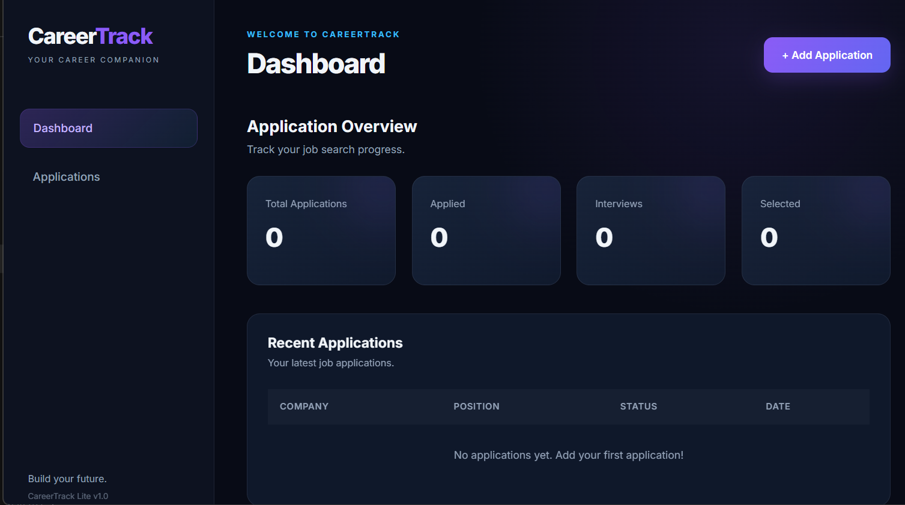
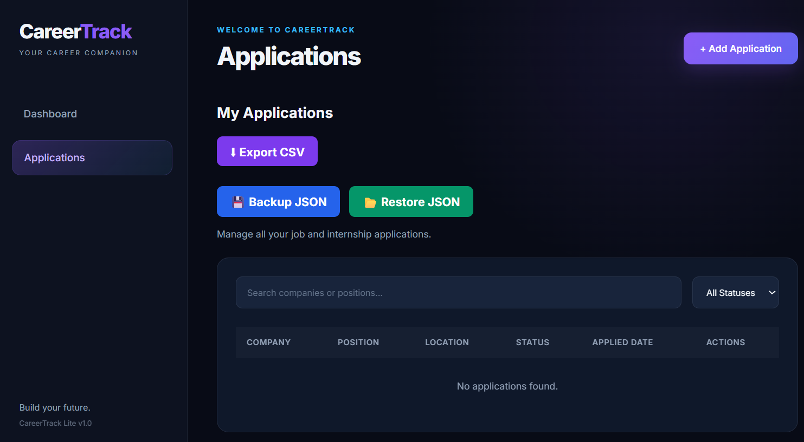
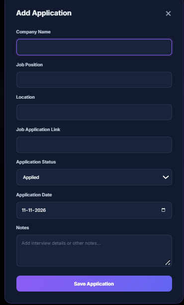

# CareerTrack Lite

CareerTrack Lite is a responsive job application tracking application built using HTML, CSS, and JavaScript. It helps users organize and monitor their job applications in one place.

## Features

- Add new job applications.
- View total applications on the dashboard.
- Track application statuses.
- Search applications by keywords.
- Filter applications by status.
- Edit existing applications.
- Delete applications.
- Automatically save data using Local Storage.
- Export applications as CSV.
- Backup and restore application data using JSON.
- Responsive design for desktop and mobile devices.

## Technologies Used

- HTML5
- CSS3
- JavaScript
- Browser Local Storage

## Project Structure

```text
CareerTrack/
│
├── index.html
├── style.css
├── script.js
└── README.md
```

## How to Run

1. Download or clone this repository.
2. Open the project folder.
3. Open `index.html` in your browser.
4. Start managing your job applications.

No additional software installation is required.

## Data Storage

CareerTrack Lite uses browser Local Storage to save application data.

Data is stored in the user's browser and does not automatically synchronize between devices or browsers. JSON Backup and Restore can be used to transfer application data.

## Future Improvements

- Cloud database integration.
- User authentication.
- Cross-device synchronization.
- Application reminders.

- ## Screenshots

### Dashboard


### Applications


### Features

